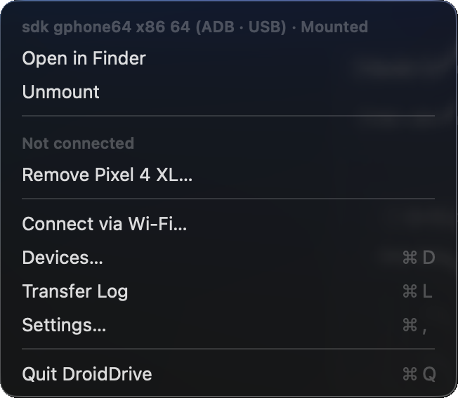
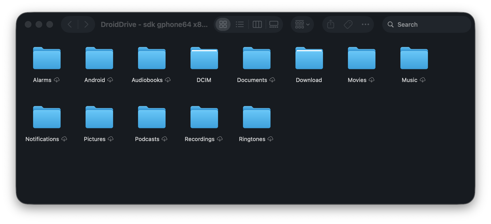
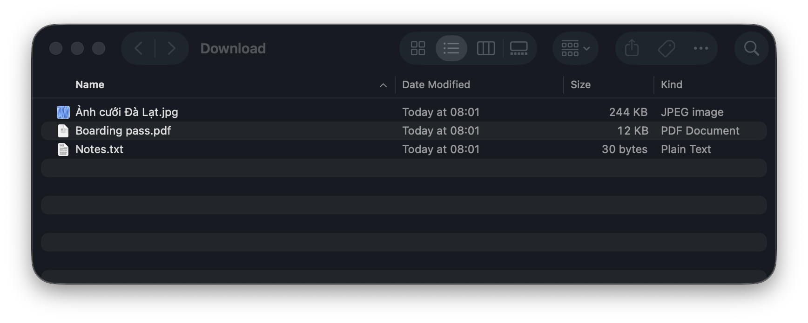
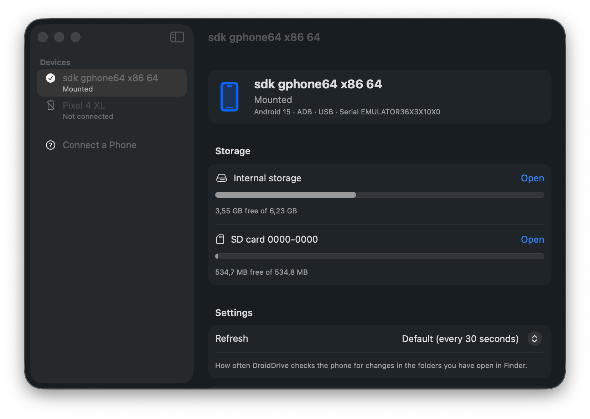
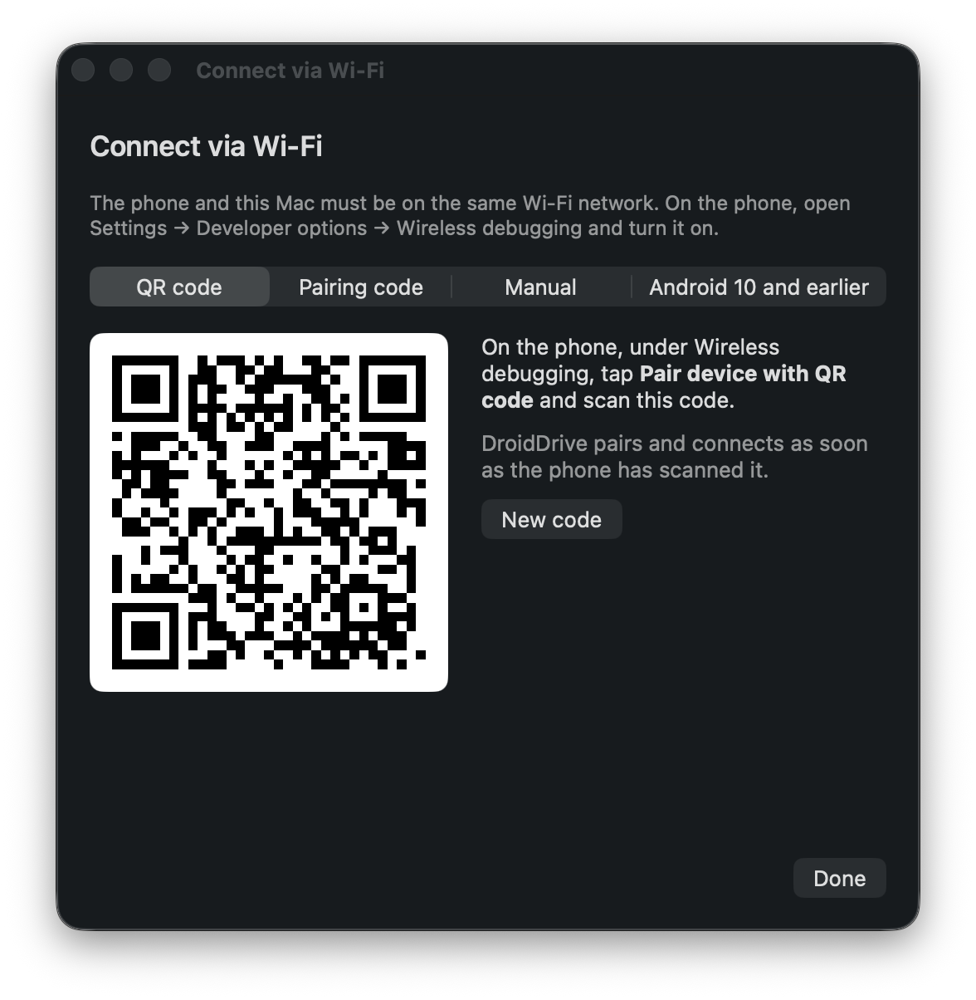

# DroidDrive

DroidDrive is a macOS app that mounts an Android phone in Finder as a drive, so you can browse, open, edit and copy files the way you would on a USB stick. macOS cannot read Android phones on its own (Android speaks MTP, the Mac only understands the cameras' PTP), and Google's Android File Transfer is no longer maintained. DroidDrive uses File Provider, the mechanism behind iCloud Drive and Google Drive, so it needs no macFUSE and no kernel extension.

It connects over Wi-Fi (Android 11+ wireless debugging, paired by QR code or 6-digit code), over USB with ADB, or over USB with MTP. Each storage of the phone (internal storage, SD card) becomes its own drive under Locations in the Finder sidebar.

<p align="center">
  
</p>

<p align="center">
  
</p>

<p align="center">
  
</p>

<p align="center">
  
  
</p>

Screenshots taken with the Android Emulator.

## Status

A personal project, working day to day with a Pixel 4 XL over Wi-Fi. What has been tested where:

| Feature | State |
|---|---|
| Wi-Fi, paired in DroidDrive (QR code) | Works on a real phone (Android 13) |
| ADB through the user's adb server (USB or `adb connect`) | Works on the emulator and a real phone |
| Finder: browse, open, create, rename, move, edit, delete, Unicode names, conflicts, offline edits | Works on the emulator and a real phone |
| ADB over USB without an adb server | Written and tested against fake USB pipes; not yet run on a real phone |
| MTP over USB | Written and tested against a fake MTP phone; not yet run on a real phone |

Large folders open slowly the first time (about 30 ms per entry, spent in macOS's fileproviderd). The details, measurements and known limits are in [`docs/spikes.md`](docs/spikes.md); the design is in [`docs/spec.md`](docs/spec.md) and the task list in [`docs/plan.md`](docs/plan.md).

## Requirements

- macOS 13 or later (developed and tested on macOS 26).
- Xcode 26 or later and [XcodeGen](https://github.com/yonaskolb/XcodeGen) to build.
- An Android phone with Developer options turned on: Wireless debugging (Android 11+) or USB debugging, or "File transfer" mode for MTP.

## Build and run

The Xcode project is generated from `project.yml` and not committed. No signing team is committed either: put yours in `Config/Signing.local.xcconfig` (git-ignored), because the app and its File Provider extension share data through the app group `<team id>.com.droiddrive`. Your team id is in Xcode → Settings → Accounts, or in the `OU` field of `security find-identity -v -p codesigning`.

```sh
echo 'DEVELOPMENT_TEAM = ABCDE12345' > Config/Signing.local.xcconfig   # your team id
xcodegen generate
xcodebuild -project DroidDrive.xcodeproj -scheme DroidDrive -configuration Release \
  -derivedDataPath build/app \
  CODE_SIGN_STYLE=Manual CODE_SIGN_IDENTITY="Apple Development" PROVISIONING_PROFILE_SPECIFIER= build
cp -R build/app/Build/Products/Release/DroidDrive.app /Applications/
open /Applications/DroidDrive.app
```

The first time a drive is mounted, macOS keeps it switched off. Turn DroidDrive on under System Settings → General → Login Items & Extensions → File Providers; the DroidDrive menu has a button that opens that page.

DroidDrive lives in the menu bar and has Devices, Connect via Wi-Fi, Transfer Log and Settings windows. It finds phones through the adb server (when one is running), over USB (ADB or MTP), and over Wi-Fi for phones paired in Connect via Wi-Fi. The File Provider extension reaches the phone through the app over XPC, so the app must be running for the drives to read and write; "Open at login" is on by default.

To update the installed copy after changing the code: build again, quit DroidDrive, copy the new `DroidDrive.app` over the one in `/Applications`, and open it.

## Everyday use

1. On the phone, turn on Developer options → **Wireless debugging**. Android turns it off when the phone restarts or changes Wi-Fi network. The phone and the Mac must be on the same Wi-Fi network.
2. A few seconds later the DroidDrive menu shows the phone as "Mounted" and the drive appears in the Finder sidebar under Locations. No need to pair again.
3. Use the drive like any folder. When you are done, just turn Wireless debugging off; files you opened stay on the Mac, and changes not yet sent go out the next time the phone connects.

## Connecting over Wi-Fi the first time

There are two ways.

- **In DroidDrive:** menu → Connect via Wi-Fi…, then scan the QR code (on the phone: Wireless debugging → Pair device with QR code) or enter the 6-digit pairing code. DroidDrive pairs, connects, and reconnects by itself later.
- **With adb:** any phone the adb server sees, DroidDrive sees too. On the phone choose Wireless debugging → Pair device with pairing code, then run the two commands below on the Mac. The `pair` and `connect` ports differ; both are shown on the phone (`adb mdns services` also lists them).

```sh
adb pair 192.168.1.23:37123        # enter the 6-digit code
adb connect 192.168.1.23:41234
```

Drives are named after the phone's own serial number, so changing ports or switching between USB and Wi-Fi keeps the same drive.

## Tests

Unit tests need no device. Integration tests run only when an environment variable points at a device: the emulator, or a real phone that allows ADB.

```sh
cd Packages
swift test                                              # unit tests
DROIDDRIVE_ADB_SERIAL=emulator-5554 swift test          # plus integration tests through the adb server
DROIDDRIVE_ADB_SERIAL=<serial> DROIDDRIVE_TEST_ROOT=/storage/emulated/0/DroidDriveTest \
  swift test --filter IntegrationTests                   # on a real phone, writing only inside that folder
DROIDDRIVE_ADB_DIRECT=127.0.0.1:5555 swift test \
  --filter IntegrationTests                              # straight to adbd (stop the adb server first)
```

Three command-line tools live in `Packages/` and are not shipped in the app: `droiddrive-cli` drives the ADB client directly (quick checks, speed comparisons with `adb`), `droiddrive-usb` probes USB and MTP, and `droiddrive-wifi` tries Wi-Fi pairing and connections (`discover`, `pair`, `qr`, `connect`). For example:

```sh
swift run -c release droiddrive-cli storages
swift run -c release droiddrive-cli push ./big.bin /storage/emulated/0/Download/big.bin
```

## Repository layout

| Path | What it is |
|---|---|
| `App/` | Menu-bar app (SwiftUI): device sources, windows, XPC link to the extension |
| `FileProvider/` | The File Provider (replicated) extension |
| `Packages/` | Swift package with the layers: `DroidCore`, `AdbKit`, `UsbKit`, `MtpKit`, `AdbPairing` (+ `CSpake2` from BoringSSL), `ItemStore`, `DeviceService`, and the CLI tools |
| `docs/` | Specification, plan, spike results, screenshots |
| `spikes/fskit/` | A throwaway FSKit module from spike S0-d (not used by the app) |
| `scripts/release.sh` | Archive, Developer ID signing, notarization and DMG |

## License

DroidDrive is released under the [MIT License](LICENSE). `Packages/Sources/CSpake2/` contains code from BoringSSL and fiat-crypto under their own licenses, kept next to that code.
